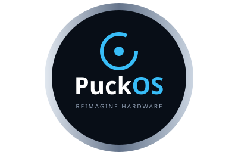
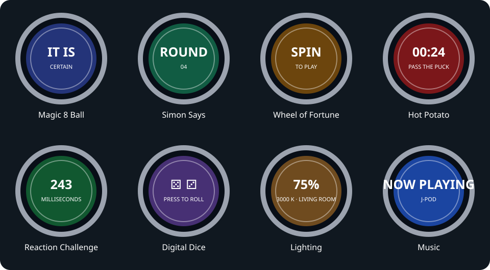
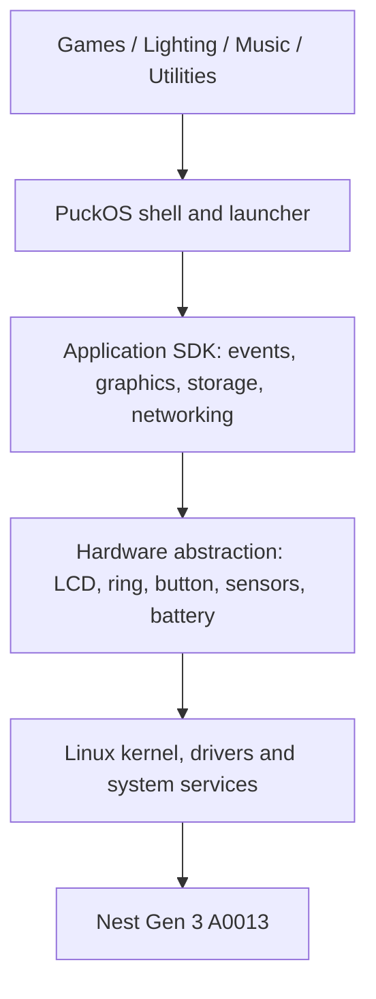

<p align="center"></p>

# PuckOS

**Old hardware. New possibilities.**

An experimental open-source embedded Linux platform for repurposing retired Nest Learning Thermostats into interactive gaming, lighting, home automation and utility devices.

Formerly Google-Shun. Initial target: North American Nest Learning Thermostat, third generation, A0013 (diamond3). PuckOS is an early working native-application prototype running on rooted stock Linux. It is not yet an independent operating system or flashable release.

## Current status

On US Gen 3 hardware (Display-3.7, firmware `6.2-27`), unfr0zen v0.6.0 enabled root access, USB console and SSH. Native ARMv7 diagnostics and a graphical color-wheel demo have run on physical hardware. LCD rendering, rotary input and button press/release events have been verified. The initial demo averaged 2.3 FPS; renderer optimization remains pending.

- [Development and deployment instructions](docs/development.md)
- [Firmware 6.2-27 hardware findings](docs/firmware/6.2-27.md)
- [ARMv7 CI builds](https://github.com/jn90z/puckOS/actions)

A 512 MiB NAND backup was created and its SHA256 verified, but the first 512 KiB read reported error -74. Full restoration has not been tested. Upstream acceptance of this firmware version is pending.

## Acknowledgments

PuckOS development on the original Nest hardware is made possible by [unfr0zen](https://github.com/unfr0zen/unfr0zen) and its contributors. Their recovery, firmware patching and root-access work provides the foundation for our native applications. We are grateful for their research and tooling and intend to contribute reproducible compatibility findings and relevant improvements upstream.

PuckOS is an independent project, not affiliated with or endorsed by unfr0zen, Google or Nest. Original PuckOS code is MIT-licensed; unfr0zen is GPL-3.0-licensed and third-party components retain their respective licenses.

## Design goals

- Retain the original display assembly, rotary ring, push button, sensors and battery.
- Use 5 V USB power exclusively. No HVAC wiring or 24 VAC, ever.
- Operate independently of the HVAC baseplate and proprietary cloud.
- Provide a modular launcher and native application SDK.
- Preserve factory recovery and battery/thermal protection.
- Start with stock Linux drivers and progress toward an independently bootable Buildroot Linux distribution.

## Hardware reference

The table distinguishes observations on our US Gen 3 unit from preliminary hardware research. Regional and board revisions may differ.

| Component | Reported specification / status |
|---|---|
| SoC | NXP i.MX6 SoloX, Cortex-A9 around 1 GHz; Cortex-M4 coprocessor |
| RAM / NAND | 512168 kB reported by Linux at initial inspection / 512 MiB NAND verified |
| Display | Circular viewing area; verified framebuffer 480 × 640, virtual 480 × 1280, 32 bpp. Visible-area alignment still being calibrated. |
| Input | Rotary ring (REL_DIAL) and mechanical push (KEY_ENTER), both verified |
| Sensors | Temperature, humidity, proximity, motion and ambient light; identify which are in display versus base |
| Wireless | Wi-Fi, BLE, IEEE 802.15.4; verify usable interfaces |
| USB | Micro USB, charging and potential recovery/data interface |
| Battery | Rechargeable lithium-ion; capacity and health TBD |
| Vibration / accelerometer | Not documented; do not assume present |
| Stock OS | Embedded Linux |

See [Google hardware specifications](https://support.google.com/googlehome/answer/9230098?hl=en). Motion detection is not evidence of an accelerometer. Verify processor, memory, input devices and sensor access before selecting drivers.

## Application concepts



*Original static concept illustrations, not screenshots of working firmware.*

| Application | Interaction |
|---|---|
| Magic 8 Ball | Ask a question, spin, cover the light sensor or wave a hand, then press for a randomized animated answer. First proof of concept. |
| Simon Says | Repeat a color sequence using ring and button. |
| Wheel of Fortune | Spin a virtual wheel for players, chores, prizes or dinner choices. |
| Hot Potato | Pass the puck during a randomized countdown; complete a challenge and press before passing. |
| Reaction Challenge | Press when the display turns green; save family high scores. |
| Digital Dice | D4–D20, custom dice and coin flips. |
| Other family games | Trivia, charades, word guessing, code-breaking, chess clock, virtual pet and proximity games. |
| Lighting controller | Ring adjusts brightness, CCT or RGB; press selects mode, room or scene. Target MQTT, Home Assistant and WLED. |
| Music | Navidrome/J-Pod remote, album art, track navigation and volume. Requires a compatible playback endpoint. |
| Utilities | Clock, weather, timers, environmental readings and server monitoring. |
| Engineering | Remote bench power-supply status and controls, with appropriate safety limits. |

Lighting concept: tunable white 1800–6500 K, brightness 0–100%, scene selection and local network control. Actual ranges depend on the connected lights.

## Power and enclosure

The original baseplate is available but will never receive 24 VAC. The stock display has been observed to boot far enough to request connection to the base. This suggests a software or hardware-service dependency, not proof that the base is needed for initial boot.

Test USB-only operation with and without the unpowered base, using a data-capable cable. A right-angle micro USB cable may permit physical attachment if clearance allows. Do not force the connector. Verify charging, enumeration, current draw, thermal behavior and battery runtime. Investigate the base-detection logic after obtaining a shell.

Future printed enclosure: recessed USB cable, connector protection, rubber feet, desktop charging dock, wall mount and optional magnetic docking. Optional later hardware: accelerometer, haptics, speaker, USB-C or RGB halo. No hardware modifications required for the intended core platform.

Operating modes: handheld games, desktop dock, wall-mounted smart controller.

## Proposed architecture



Candidate implementation: C/C++, SDL2 or LVGL depending on available graphics interfaces, native event handling, local storage, MQTT and optional network services. Buildroot is a candidate for the eventual independent image. A desktop simulator should support virtual ring/button events and the circular display.

## Prior art and research

| Resource | Relevance |
|---|---|
| [Unfr0zen](https://github.com/unfr0zen/unfr0zen) | Enabling upstream project; USB recovery, root and SSH verified on our unit. Restore not tested. |
| [Unfr0zen releases](https://github.com/unfr0zen/unfr0zen/releases) | Windows recovery and setup tooling used successfully (v0.6.0). |
| [QEMU fork](https://github.com/unfr0zen/qemu) | Candidate Gen 2/3 firmware emulation. |
| [Buildroot fork](https://github.com/unfr0zen/buildroot) | Embedded Linux build research. |
| [Fledge discussion](https://www.reddit.com/r/homeassistant/comments/1xsrrmy/fledge_turn_your_nest_learning_thermostat_into_a/) | Reported custom smart-home interface on UK Gen 3; US compatibility and source availability need verification. |
| [NestDFUAttack](https://github.com/gtvhacker/NestDFUAttack) | Historical older-generation USB exploit; do not assume Gen 3 compatibility. |
| [Nest Hacking Wiki](https://wiki.exploitee.rs/index.php/Nest_Hacking) | Historical reverse engineering. |
| [NoLongerEvil](https://github.com/codykociemba/NoLongerEvil-Thermostat) | Earlier-generation cloud replacement research. |

Community claims are leads, not PuckOS test results. Verify upstream documentation, releases, firmware compatibility and licenses before use. Previously identified candidate Gen 3 firmware versions: 5.9.4-5, 6.3-5, 6.4-8 and 6.5-14; confirm against upstream. Candidate USB VID:PID identifiers: 15A2:0071 (ROM), 18D1:4EE0 (recovery), 0525:A4A7 and 0525:B4A4 (custom recovery), 2464:0030 and 2464:0031 (application). Confirm actual enumeration; Android USB drivers may conflict.

## Initial development checklist

- [x] Record hardware and firmware revision.
- [x] Enumerate USB devices before and after connecting display.
- [x] Confirm recovery access and successful setup on firmware 6.2-27.
- [x] Create original NAND backup and verify file checksum; keep backups private.
- [ ] Resolve initial NAND read warning and validate restore capability.
- [x] Establish root shell and document partition layout and hardware interfaces.
- [x] Test LCD rendering, rotary ring and push button.
- [ ] Validate environmental sensors and beeper.
- [ ] Investigate baseplate dependency and USB-only operation.
- [ ] Run standalone Magic 8 Ball proof of concept.
- [ ] Validate recovery and rollback before distributing any flashable image.

Windows USB enumeration:

```powershell
Get-PnpDevice -PresentOnly |
    Where-Object { $_.InstanceId -like "USB*" } |
    Format-Table Status, FriendlyName, InstanceId -AutoSize
```

## Roadmap

| Version | Planned milestone |
|---|---|
| 0.1 | Root, backup and recovery |
| 0.2 | Hardware diagnostics and abstraction |
| 0.3 | Graphical shell and launcher |
| 0.4 | Desktop simulator |
| 0.5 | Magic 8 Ball and family games |
| 0.6 | Lighting and home automation |
| 0.7 | Application SDK |
| 0.8 | Battery and power optimization |
| 0.9 | Standalone Linux firmware |
| 1.0 | Recoverable flashable PuckOS distribution |

Root access is not equivalent to arbitrary firmware boot. Bootloader restrictions, driver availability, standalone operation and safe power management remain open questions.

## Project status and licensing

Experimental, pre-alpha. Development deployment instructions are available, but no supported standalone firmware installation exists. Do not flash unverified images or publish device-specific backups, credentials or identifiers.

Original PuckOS software is licensed under the [MIT License](LICENSE). The independently distributed unfr0zen project is licensed under [GPL-3.0](https://github.com/unfr0zen/unfr0zen/blob/main/LICENSE). Use of its tools does not relicense independent PuckOS applications. Any future incorporation or redistribution of covered third-party code must preserve applicable notices and satisfy its license obligations. No factory firmware images or device backups are intended for distribution. Formal project name clearance remains open.

Suggested repository topics: embedded-linux, nest-thermostat, custom-firmware, reverse-engineering, buildroot, iot, home-automation, retro-gaming, hardware-reuse, puckos.
